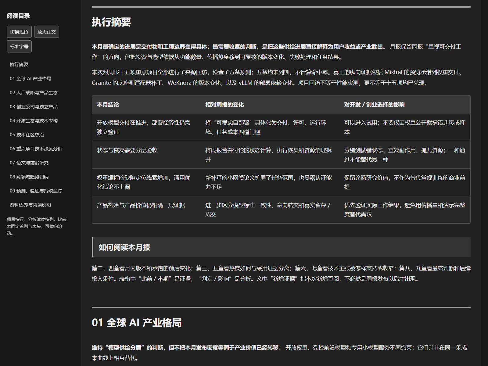
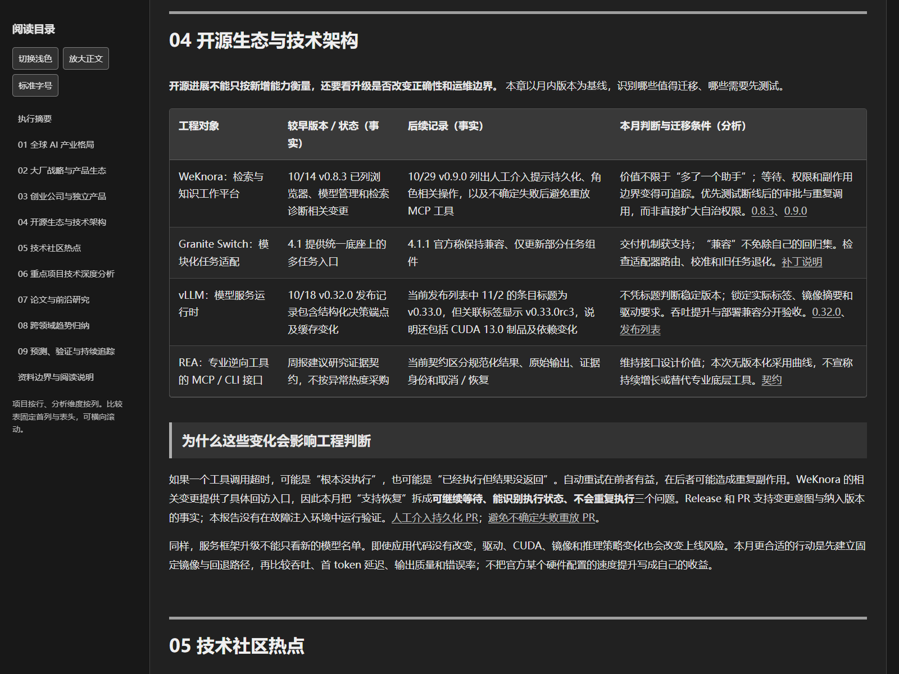

# AI Ecosystem Research · AI 生态研究

一个帮助 AI 开发者与创业者持续研究全球 AI 生态的 **Codex skill**。它指导 AI 助手检索来源、解释项目、比较技术方案、追踪判断，并生成便于阅读的研究报告。

**先观察事实，再判断热度，最后归纳趋势。** 不只汇总新闻，也不预先选定热点再寻找佐证。

## 生成效果与完整示例

下面是 skill 实际生成的月报，经脱敏后保留完整九章。截图来自同一份 HTML 阅读版，展示中性灰深色主题、目录和结论先行的摘要。

[](examples/monthly-report/report.md)

**[在线阅读完整月报（Markdown）](examples/monthly-report/report.md)** · **[获取灰色深色 HTML](examples/monthly-report/report-dark.html)**

GitHub 的 HTML 文件页显示源码；在文件页点击 **Download raw file**，保存后用浏览器打开，即可使用目录、主题切换和宽表滚动。也可下载整个仓库后打开 `examples/monthly-report/report-dark.html`，无需安装依赖。

这份示例如何体现月报与周报的区别：

| 阅读位置 | 可以看到什么 |
|---|---|
| 第二、四章 | 对照较早版本、后续交付和变化对选型的影响 |
| 第六、八章 | 复核技术主张，说明判断为何维持、收窄或细化 |
| 第九章 | 回访原重点项目，保留预测期限与未定结论 |



示例保留原研究窗口（2026-10-06 至 2026-11-05）和资料限制，**不是当前新闻或持续更新的数据看板**。公开整理移除了个人化信息及本地历史链接；未随附私人台账，也没有重新验证全部外部材料。项目名和结论只存在于示例中，不是 skill 预设。

## 能帮你做什么

| 模式 | 主要回答 | 产出重点 |
|---|---|---|
| 周报 | 最近出现了哪些值得关注的变化？ | 新发布与重要更新、独立社区榜单、项目介绍、技术深析和待验证假设 |
| 月报 | 之前关注的项目和判断，经得起后续证据检验吗？ | 历史版本与交付比较、原项目回访、预测核验、判断修正与投入条件 |
| 专题 | 某个项目或技术机制究竟如何工作？ | 架构、源码或公开接口、替代方案、实验条件、争议与采用边界 |

完整周报和月报共用九层框架，但研究任务不同：**周报侧重发现，月报侧重纵向验证**。专题按问题展开，不强行填满九章。

报告默认中文、面向开发者与创业者，采用结论先行的叙事和“项目按行、比较维度按列”的表格。HTML 阅读版有中性灰深色主题、清晰标题、目录、宽表滚动和浅色切换。

## 快速开始

### 1. 安装 skill

在 Codex 中发送：

```text
使用 $skill-installer，从 https://github.com/X0luka/ai-ecosystem-research
安装 skills/ai-ecosystem-research 目录中的 skill。
```

安装后在可用技能中确认 `ai-ecosystem-research`。如果没有出现，重启 Codex。只选一种安装方式，避免同名 skill 重复加载。

也可以手动安装：下载仓库 ZIP，将完整的 `skills/ai-ecosystem-research` 文件夹复制到目标研究项目的 `.agents/skills/` 中，最后应能看到：

```text
你的研究项目/
└── .agents/skills/ai-ecosystem-research/SKILL.md
```

在这个研究项目中启动 Codex。用户级安装目录和发现机制见 [OpenAI 官方技能文档](https://learn.chatgpt.com/docs/build-skills#where-codex-loads-local-skills)。

### 2. 生成第一份周报

在你准备保存研究资料的项目中发送：

```text
使用 $ai-ecosystem-research 生成截至今天的全球 AI 生态周报。
面向 AI 开发者和创业者，保留九层框架。
先检索再归纳，解释项目做什么、为何值得关注及采用条件。
保存证据与待验证判断，并生成灰色深色 HTML 阅读版。
```

执行研究需要宿主提供联网检索、网页读取和本地文件读写能力。生成 HTML 另需 **Node.js 20 或更新版本**；无需 `npm install`。项目自身不要求 API Key，模型与联网服务由你使用的 AI 助手提供，相关费用由宿主决定。

### 3. 在同一研究目录继续做月报

```text
使用 $ai-ecosystem-research 生成过去 30 个完整日的 AI 生态月报。
读取 research/ 中此前的周报、项目和预测，回访重点对象。
比较历史版本与当前证据，说明哪些判断维持、收窄、修订或仍无法判断。
不要拼接周报；保留九层框架、事实与分析分列和灰色深色版。
```

没有足够历史时，skill 会先寻找可核验的历史发布和版本；仍不足则明确生成有限覆盖复盘或基线研究，不虚构整月增长和预测命中率。默认周报取七个完整日、月报取三十个完整日；也可指定“上一个自然月”、时区或截止日期。

专题示例：

```text
使用 $ai-ecosystem-research 分析我提供的项目链接。
重点研究执行恢复机制，与两个可比方案对照，区分源码阅读和实际运行结果。
```

## 报告和历史保存在哪里

默认写入当前工作目录的 `research/`，不写入 skill 安装目录：

```text
research/
├── projects.json          # 项目历史
├── predictions.json       # 判断、期限与后续核验
└── runs/<日期>/<模式-主题>/
    ├── report.md          # 正文及来源链接
    ├── report-dark.html   # 请求 HTML 时生成
    ├── evidence.json      # 证据记录
    ├── coverage.md        # 研究覆盖范围
    ├── acceptance.md      # 本次核验与真实限制
    └── review.json        # 月报的纵向回访索引
```

按任务另存候选、榜单和指标快照。换电脑时，**skill 文件夹和 `research/` 历史都要迁移**；只安装 skill 不会带走过去的判断。保留研究目录内部的相对路径，历史报告间链接才能继续使用。

## 单独体验阅读版

仓库提供一个明确标注为虚构数据的[排版示例](examples/reading-demo.md)，仅展示纵向比较与阅读结构，不是实际研究报告。

安装 Git 和 Node.js 后，在终端依次执行（Windows PowerShell、macOS、Linux 均可）：

```sh
git clone https://github.com/X0luka/ai-ecosystem-research.git
cd ai-ecosystem-research
node skills/ai-ecosystem-research/scripts/render-report.cjs --input examples/reading-demo.md --output output/reading-demo.html --theme dark
```

用浏览器打开生成的 `output/reading-demo.html`。渲染器只把现成 Markdown 排版成 HTML，**不会联网研究或自动生成报告内容**。将 `--input` 换成自己的 Markdown 即可；`--theme light` 可设置默认浅色。

## 九层研究框架

1. 全球 AI 产业格局
2. 大厂战略与产品生态
3. 创业公司与独立产品
4. 开源生态与技术架构
5. 技术社区热点
6. 重点项目技术深度分析
7. 论文与前沿研究
8. 跨领域趋势归纳
9. 预测、验证与持续追踪

GitHub、Hugging Face、Hacker News、独立产品和论文分别看待，不合成跨平台总热度分。榜单用于发现，不直接代表技术价值。

## 修改偏好与参与贡献

当前请求可以覆盖默认语言、范围、格式和时区。长期偏好修改安装目录中的 [reader-profile.md](skills/ai-ecosystem-research/references/reader-profile.md)。修改仓库副本后，需要将更新同步到自己的安装目录。

项目核心在 [SKILL.md](skills/ai-ecosystem-research/SKILL.md)，模式规则在 [report-templates.md](skills/ai-ecosystem-research/references/report-templates.md)，证据纪律在 [evidence-rules.md](skills/ai-ecosystem-research/references/evidence-rules.md)。欢迎通过 Issue 或 PR 提供可复现的问题与改进。

修改渲染器后运行：

```sh
node tests/renderer.test.cjs
```

测试检查跨目录运行、输入保留、危险链接处理和灰色主题；不代表研究结论已经被验证。涉及排版的改动还需在浏览器中检查真实显示。

## 能力边界与许可

这是研究工作流与阅读工具，不是无人值守爬虫，也不自带订阅、定时任务或付费数据源。研究质量取决于宿主能力和可访问来源；没有历史快照、私人业务数据或实测条件时，必须保留不确定性。查看源码不等于运行验证，模型评测不等于真实业务收益。

采用 [MIT License](LICENSE)。内置 Markdown 解析器 Marked 的原始许可保留在 [marked-LICENSE.md](skills/ai-ecosystem-research/scripts/vendor/marked-LICENSE.md)。仓库仅包含公开整理的报告示例和纯报告页面截图，不包含私人研究台账、聊天界面截图或第三方网页采集档案。外部来源内容仍归其各自权利人所有。
